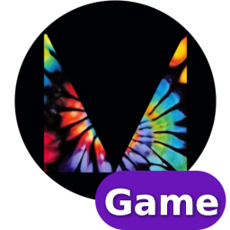
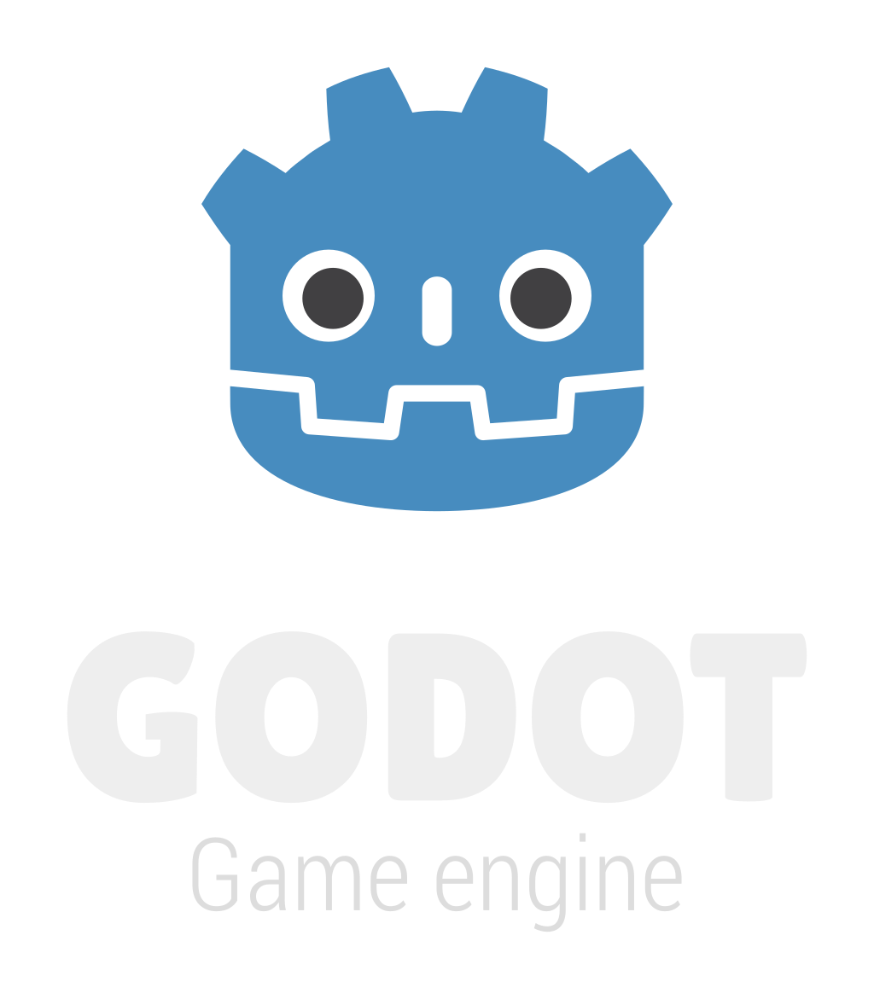
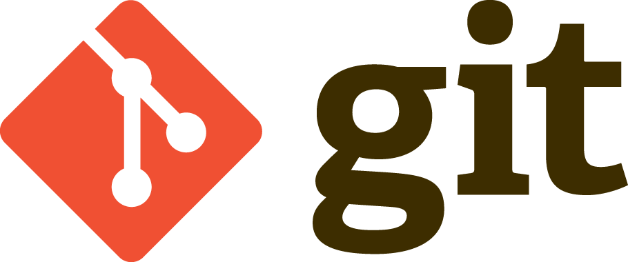

[font_size=48]Anda Dipromosikan[/font_size]
[font_size=32]Menjadi Minion Dungeon[/font_size]

Setelah Demon Lord melihat hasil kerja keras mu, ia terasa kagum.
Tnpa basa basi ia mempromosikanmu menjadi minion dungeon.

Ternayata benar, kerja keras pasti terbalaskan

[font_size=48]Team[/font_size]
[font_size=24]Sci-FY Production[/font_size]
Fadli Haidar 
Muhammad Yazid Zinky Arisona 
Muhammad Satrio Pratama

[font_size=32]Thank You Live2Dev 2026[/font_size]

# Attribution
## Collaborators

### Godot Game Template
  
Author: [Marek Belski and contributors](https://github.com/Maaack/Godot-Game-Template/graphs/contributors)  
Source: [github: Godot-Game-Template](https://github.com/Maaack/Godot-Game-Template)  
License: [MIT License](LICENSE.txt)  

## Sourced
#### Godot Engine Logo
Author: Andrea Calabró  
Source: [godotengine.org : press](https://godotengine.org/press/)  
License: [CC BY 4.0 International](https://github.com/godotengine/godot/blob/master/LOGO_LICENSE.txt) 

#### Git Logo
Author: [Jason Long](https://bsky.app/profile/jasonlong.me)  
Source: [git-scm.com : logos](https://git-scm.com/downloads/logos)  
License: [CC BY 3.0](https://creativecommons.org/licenses/by/3.0/) 

## Tools
#### Godot
  
Author: [Juan Linietsky, Ariel Manzur, and contributors](https://godotengine.org/contact)  
Source: [godotengine.org](https://godotengine.org/)  
License: [MIT License](https://github.com/godotengine/godot/blob/master/LICENSE.txt)  

#### Visual Studio Code
Author: [Microsoft](https://opensource.microsoft.com/)  
Source: [github: vscode](https://github.com/microsoft/vscode)  
License: [MIT License](https://github.com/microsoft/vscode/blob/main/LICENSE.txt)

#### Git
  
Author: [Linus Torvalds](https://github.com/torvalds)  
Source: [git-scm.com](https://git-scm.com/downloads)  
License: [GNU General Public License version 2](https://opensource.org/licenses/GPL-2.0)

Sounds by JDSherbert – https://jdsherbert.itch.io
